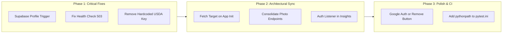

# Calorie Tracker Application — Engineering Handover & Code Audit

**Date:** October 2026  
**Repositories:**
- **Backend:** `Curtis-18/calorie_backend` (`/home/curtis/calorie_backend`) — Hosted on **Render** (Frankfurt)
- **Frontend:** `Curtis-18/calorie_app` (`/home/curtis/calorie_app`) — Hosted on **Vercel** (Flutter Web / Mobile)
- **Database & Auth:** **Supabase** (PostgreSQL + Supavisor Pooler + Supabase Auth)

---

## 1. Executive Summary & Architecture Overview

The Calorie Tracker system is a cross-platform nutrition and meal tracking application. It consists of a **FastAPI backend** running on Render and a **Flutter client** (Web / Android / iOS) deployed on Vercel. 

### High-Level Architecture Diagram

```mermaid
flowchart TD
    subgraph Client["Flutter Frontend (Vercel / Mobile)"]
        UI[Cupertino UI & Riverpod Notifiers]
        LocalStorage[(SharedPreferences Cache)]
    end

    subgraph Supabase["Supabase Cloud"]
        SupaAuth[Supabase Auth (GoTrue)]
        Postgres[(PostgreSQL DB + Pooler :6543)]
    end

    subgraph Backend["FastAPI Backend (Render)"]
        API[FastAPI Endpoints]
        JWKS[PyJWKClient ES256 Token Verification]
        Calculator[Target & Macro Engine]
    end

    subgraph External["External Services"]
        Gemini[Google Gemini API]
        USDA[USDA FoodData Central]
        MealDB[TheMealDB API]
    end

    UI -->|JWT Auth & Registration| SupaAuth
    UI -->|Cached Day Read/Write| LocalStorage
    UI -->|Direct Queries / Fallback| USDA
    UI -->|Browse & Search Recipes| MealDB
    UI -->|API Requests Bearer JWT| API

    API -->|Fetch Public JWKS Keys| SupaAuth
    API -->|SQLAlchemy AsyncPG| Postgres
    API -->|Identify Foods & Insights| Gemini
    API -->|Proxied Nutrient Search| USDA
```

---

## 2. Technology Stack & Infrastructure

| Layer | Technology | Hosting / Provider | Details |
|---|---|---|---|
| **Frontend** | Flutter 3.12+ (Dart), Riverpod 2.5, Cupertino / Custom Theme, FL Chart | **Vercel** (Flutter Web build) | Single-page web deployment configured via `vercel.json` rewrites |
| **Backend** | Python 3.13 / FastAPI 0.142, Pydantic 2.13, SQLAlchemy 2.1 (AsyncIO), Uvicorn/Gunicorn | **Render** (Free Web Service) | Uses `uvicorn.workers.UvicornWorker` across 2 workers; auto-deploys on commit |
| **Auth** | Supabase Auth (JWT ES256 asymmetric signatures via JWKS) | **Supabase** | Client exchanges login credentials directly with Supabase |
| **Database** | PostgreSQL with connection pooling via Supavisor (port 6543) | **Supabase** | `NullPool` configured on SQLAlchemy asyncpg engine |
| **AI / ML** | Google Gemini (`gemini-3.6-flash`) | **Google AI Studio** | Used for meal photo parsing and weekly nutritional coaching |
| **Nutritional Data** | USDA FoodData Central REST API | **USDA** | Nutrient breakdown (calories, protein, carbs, fats) |
| **Recipes** | TheMealDB REST API | **TheMealDB** | Public recipe lookup and search for meal inspiration |

---

## 3. End-to-End Application Workflows

### 3.1 Authentication & Onboarding Gate
1. **User Sign Up / Sign In:** Handled on the client using `Supabase.instance.client.auth.signUp()` or `signInWithPassword()`.
2. **Session Verification:** `AuthGate` listens to `onAuthStateChange`. When an active session is detected, it requests `GET /targets` from the backend using the Bearer access token.
3. **Routing Decision:**
   - **HTTP 200:** Profile exists and onboarding targets are complete $\rightarrow$ Navigates to `MainShell` (Dashboard).
   - **HTTP 404:** Authenticated user has not completed onboarding $\rightarrow$ Navigates to `OnboardingScreen`.
   - **Network Error / 5xx:** Renders `_RetryScreen` ("Could not reach the server").
4. **Onboarding Submission:**
   - User enters Date of Birth, Gender, Height, Weight, Activity Level, and Primary Goal (Lose / Maintain / Gain).
   - Client sends `POST /targets` to the backend.
   - The backend `calculate_targets()` runs Mifflin-St Jeor BMR math, applies TDEE multipliers, enforces a minimum 1200 kcal floor, calculates protein, fat, and carbohydrate ratios, and upserts the row into the `targets` PostgreSQL table.
   - Client saves targets locally to `SharedPreferences` and transitions to `/dashboard`.

### 3.2 Daily Food Logging
The dashboard manages meals under four categories: **Breakfast**, **Lunch**, **Dinner**, and **Snack**.
```
[User Action: Add Meal]
       │
       ├──> A. Manual Search:
       │      1. User types food query in FoodSearchScreen.
       │      2. Client queries USDA FoodData Central.
       │      3. User selects item, inputs grams in _QuantityDialog.
       │      4. FoodEntry generated.
       │
       └──> B. AI Photo Scan:
              1. Camera takes photo in DashboardScreen.
              2. PhotoEstimationService base64 encodes image.
              3. POST /estimate-photo -> Gemini returns detected foods + estimated grams.
              4. Client calls FoodSearchService.enrichDetectedFoods() against USDA.
              5. PhotoReviewScreen displays detected items with editable grams.
              6. User confirms items -> FoodEntry list generated.
       │
       v
[foodLogProvider.addEntry()]
       │
       ├──> 1. Optimistic UI update in Riverpod state
       ├──> 2. POST /logs to Backend (writes to PostgreSQL food_logs table)
       └──> 3. Persists snapshot to local SharedPreferences ('food_log_YYYY-MM-DD')
```

### 3.3 Historical Logging & Streaks
- Historical browsing does not overload the backend. The client relies on `LogCacheReader` to inspect device `SharedPreferences` for cached `food_log_<date>` keys.
- Consecutive days are computed locally to maintain the streak counter.
- Today's date always queries `GET /logs/today?date=YYYY-MM-DD` on session resume.

### 3.4 AI Coaching Insights
1. `InsightsScreen` requests `GET /insights?refresh=false` via `insightsProvider`.
2. **Backend Cache Check:** Backend checks the `insights_cache` table for the authenticated user and current date.
3. **Cache Miss / Refresh:**
   - Aggregates the last 7 days of consumption from `food_logs`.
   - Fetches user target numbers from `targets`.
   - Calls Google Gemini with `INSIGHTS_PROMPT_TEMPLATE`.
   - Implements exponential backoff retry on Gemini 429/503 spikes.
   - If Gemini is completely unavailable, returns a graceful degraded response (`degraded_insights`) so the user still sees their real weekly trends and local charts without an error screen.
   - Upserts the output into `insights_cache`.

### 3.5 Recipe Discovery
- Handled independently via `RecipeService` calling TheMealDB API.
- Users can browse categorized suggestions or perform text queries.
- Completely detached from backend databases and auth tokens.

---

## 4. Current State of the Codebase

### 4.1 Backend (`/home/curtis/calorie_backend`)

| File / Module | Responsibility | Current State |
|---|---|---|
| `app/main.py` | FastAPI application factory, CORS middleware, `/health`, `/me` endpoints | Clean. Wildcard CORS properly configured for Vercel. Health check has minor response status bug (see section 5). |
| `app/core/config.py` | Pydantic `BaseSettings`, regex wildcard parser for CORS, DB URL normalization | Robust. Automatically rewrites `postgresql://` to `postgresql+asyncpg://`. |
| `app/core/database.py` | SQLAlchemy Async Engine, `NullPool`, session dependency | Correctly configured for Supavisor pooled connection (port 6543). |
| `app/core/security.py` | JWKS client, token verification (ES256), user existence check | Validates tokens against Supabase JWKS. Checks for row in `profiles`. |
| `app/models/` | SQLAlchemy models: `user.py`, `food_log.py`, `target.py`, `insights_cache.py` | Models have proper ForeignKeys with `CASCADE` on delete. |
| `app/routers/targets.py` | `POST /targets`, `GET /targets` | Functional PostgreSQL UPSERT logic via `pg_insert`. |
| `app/routers/logs.py` | `POST /logs`, `GET /logs/today`, `DELETE /logs/{id}`, `POST /logs/analyze-photo` | Standard CRUD. Includes multipart photo analysis endpoint (unused by frontend). |
| `app/routers/photo_estimation.py`| `POST /estimate-photo` | Base64 photo estimation endpoint (used by frontend). |
| `app/routers/foods.py` | `GET /foods/search` | Proxies USDA API with backend key (unused by frontend). |
| `app/routers/insights.py` | `GET /insights` | Well implemented with degraded fallback, caching, and naive UTC normalization. |
| `app/services/` | Gemini client, USDA parser, Insights generator, Target calculator | Well unit-tested; resilient against transient Gemini outages. |
| `create_tables.py` | Out-of-band schema creation | Creates `profiles`, `targets`, `food_logs`, `insights_cache`. |
| `render.yaml` & `Procfile` | Render deployment configuration | Pins Python 3.13.5 and `uvicorn.workers.UvicornWorker`. |

### 4.2 Frontend (`/home/curtis/calorie_app`)

| File / Module | Responsibility | Current State |
|---|---|---|
| `lib/main.dart` | Root widget, Supabase initialization, configuration validation gate | Handles `MaterialLocalizations` in CupertinoApp properly. |
| `lib/config/supabase_config.dart` | Validates build-time `--dart-define` keys and URL matching | Strict project-ref validator prevents accidental key mismatch. |
| `lib/config/api_config.dart` | Backend base URL resolution | Defaults to `https://calorie-backend-odc3.onrender.com`. |
| `lib/screens/auth_gate.dart` | Auth listener, onboarding state resolution | Determines onboarding routing based on `GET /targets`. |
| `lib/screens/login_screen.dart` | Password login, Google OAuth stub | Email/password works. Google OAuth is an empty stub. |
| `lib/screens/signup_screen.dart` | Supabase email sign up | Functional. Directs users to check email if confirmation is on. |
| `lib/screens/onboarding_screen.dart`| 3-step metrics questionnaire | Working Cupertino & dark Material hybrid. |
| `lib/screens/dashboard_screen.dart` | Main logging hub, calorie ring, macro cards | Highly polished obsidian glass UI. Supports camera & manual search. |
| `lib/screens/photo_review_screen.dart`| Review and edit detected food weights | Polished UI with inline gram editing and recalculation. |
| `lib/screens/insights_screen.dart` | Narrative AI coaching & weekly trend charts | Functional FL Chart integration with refresh capability. |
| `lib/providers/` | Riverpod notifiers: `food_log_provider`, `user_provider`, `insights_provider` | Functional, but user profile sync across devices has a gap. |
| `lib/services/food_search_service.dart`| USDA search and enrichment | **Directly calls USDA with hardcoded API key** (see Section 5). |
| `lib/services/photo_estimation.dart` | Sends image to `/estimate-photo` | Converts image to Base64 and posts to backend. |
| `lib/services/recipe_service.dart` | Calls TheMealDB | Fully functional. |

---

## 5. Critical Issues, Inconsistencies & "What Seems Off"

During our comprehensive audit of both repositories, several significant discrepancies, architectural mismatches, and security issues were uncovered:

### ⚠️ Issue 1: Profiles Table Sync Gap (Silent 401 Rejection Trap)
- **Location:** Backend `app/core/security.py` (lines 50–52) vs. Database triggers.
- **The Code:**
  ```python
  result = await db.execute(select(Profile.id).where(Profile.id == user_id))
  if result.scalar_one_or_none() is None:
      raise HTTPException(status.HTTP_401_UNAUTHORIZED, "user_not_found")
  ```
- **The Problem:** 
  Every single authenticated endpoint runs `get_current_user_id()`, which rejects the request if no row exists in `public.profiles`. However, **nowhere in either the frontend or backend code is an insert into `profiles` ever executed!**
  - If Supabase does not have an active PostgreSQL database trigger (`AFTER INSERT ON auth.users FOR EACH ROW EXECUTE PROCEDURE handle_new_user()`), every newly registered user will immediately fail authentication with `401 Unauthorized ("user_not_found")`.
  - When this 401 occurs, `AuthGate` in the Flutter app misinterprets the 401 as an unreachable server and displays the `_RetryScreen` ("Could not reach the server"), completely locking the user out.

### ⚠️ Issue 2: Hardcoded Secrets & USDA Proxy Bypass
- **Location:** Frontend `lib/services/food_search_service.dart` (line 7) vs. Backend `app/routers/foods.py`.
- **The Code:**
  ```dart
  static const _apiKey = 'DN84n9OEF2cocrQnNRgCYN85qkPWRYCg9sXt6dmc';
  static const _baseUrl = 'https://api.nal.usda.gov/fdc/v1/foods/search';
  ```
- **The Problem:**
  1. A live USDA FoodData Central API key is hardcoded directly into the client Dart code and shipped in production web bundles.
  2. The backend already contains an authenticated endpoint `GET /foods/search` designed to securely proxy USDA requests to prevent quota exhaustion. The frontend completely ignores this endpoint and calls USDA directly.

### ⚠️ Issue 3: Split-Brain Photo Analysis Pipelines
- **Location:** Backend `app/routers/logs.py` (`/logs/analyze-photo`) vs. Backend `app/routers/photo_estimation.py` (`/estimate-photo`) vs. Frontend `photo_estimation.dart`.
- **The Problem:**
  - **Pipeline A (Backend):** `POST /logs/analyze-photo` takes a `multipart/form-data` upload, calls Gemini to identify items, queries USDA via `get_best_match()`, and returns fully populated nutritional values.
  - **Pipeline B (Frontend current):** The Flutter app base64-encodes the image, sends it to `POST /estimate-photo` (Pipeline B), receives names/grams, and then runs a loop in Dart calling the public USDA API directly using the hardcoded key to enrich items.
  - Having two conflicting endpoints on the backend increases maintenance overhead and results in redundant network traffic from the client.

### ⚠️ Issue 4: Profile State Desync Across Devices / Cleared Cache
- **Location:** Frontend `lib/providers/user_provider.dart` (lines 27–33).
- **The Problem:**
  `UserProfileNotifier._loadProfile()` only reads from device `SharedPreferences`. It **never calls `GET /targets` on startup**.
  - If a user signs in from a second device, opens a new private browser window, or clears local storage on Vercel, `userProfileProvider` remains `null`.
  - The Dashboard then displays default fallback values (2000 kcal target, 0g protein/carbs/fat targets).
  - Opening the profile bottom sheet prompts the user to "Set up profile", even though their targets are already saved in PostgreSQL.

### ⚠️ Issue 5: Insights Cold-Boot Authentication Race Condition
- **Location:** Frontend `lib/providers/insights_provider.dart` (lines 6–8).
- **The Code:**
  ```dart
  class InsightsNotifier extends StateNotifier<AsyncValue<InsightsData>> {
    InsightsNotifier() : super(const AsyncValue.loading()) {
      load();
    }
  ```
- **The Problem:**
  `InsightsNotifier` eagerly calls `load()` upon app launch before Supabase Auth has finished restoring the session. `InsightsService` checks `currentSession?.accessToken`, finds `null`, and immediately crashes into `AsyncValue.error(Exception('Not logged in'))`. Unlike `FoodLogNotifier`, `InsightsNotifier` does not subscribe to `onAuthStateChange`.

### ⚠️ Issue 6: Unfinished Google Sign-In Implementation
- **Location:** Frontend `lib/services/auth_service.dart` (line 5) and `lib/screens/login_screen.dart` (lines 129–132).
- **The Code:**
  - `auth_service.dart`: `static const _webClientId = 'YOUR_WEB_CLIENT_ID.apps.googleusercontent.com';`
  - `login_screen.dart`: The "Continue with Google" button has an empty callback `onPressed: () async { /* Google sign-in logic */ }`.
- **The Problem:** The button in the UI gives the impression of supporting Google sign-in, but clicking it does nothing, and the underlying service uses a placeholder client ID.

### ⚠️ Issue 7: FastAPI Health Check Status Tuple Bug
- **Location:** Backend `app/main.py` (line 65).
- **The Code:**
  ```python
  except Exception as exc:
      log.exception("health check failed")
      return {"status": "degraded", "database": "unreachable", "detail": type(exc).__name__}, 503
  ```
- **The Problem:**
  In FastAPI, returning a Python tuple `({...}, 503)` from an async route without using `JSONResponse(status_code=503)` causes FastAPI to return an **HTTP 200 OK** containing a JSON list `[{"status": "degraded", ...}, 503]`. Render's health checker evaluates the HTTP status code; because it receives a 200, it will not detect a severed database connection.

### ⚠️ Issue 8: Local Testing & Environment Setup
- **Location:** Backend `pytest.ini` and environment dependencies.
- **The Problem:**
  - The backend repository does not include `pythonpath = .` in `pytest.ini`. Running `pytest` directly without `PYTHONPATH=.` fails with `ModuleNotFoundError: No module named 'app'`.
  - The local development machine lacks an active Python virtual environment with backend dependencies installed, causing local pytest executions to fail. (Frontend Flutter tests pass: 24/24 passed).

---

## 6. Security, Configuration & Deployment Environment

### 6.1 Backend Render Configuration (`render.yaml`)

| Environment Variable | Description | Sensitivity |
|---|---|---|
| `SUPABASE_URL` | Supabase project URL (`https://<project-ref>.supabase.co`) | Configuration |
| `DATABASE_URL` | PostgreSQL connection string (`postgresql+asyncpg://...:6543/postgres`) | **Secret** |
| `USDA_API_KEY` | USDA FoodData Central developer key | **Secret** |
| `GEMINI_API_KEY`| Google AI Studio Gemini API key | **Secret** |
| `CORS_ORIGINS` | Allowed frontend origins (e.g. `http://localhost:3000,https://calorie-app-*.vercel.app`) | Configuration |

> [!IMPORTANT]
> The backend explicitly validates that origins contain no trailing slashes. Wildcards (`*`) are converted to regex matching Vercel preview domains (`https://calorie-app-*.vercel.app`). Ensure your production Vercel domain matches this pattern or is explicitly listed in `CORS_ORIGINS`.

### 6.2 Frontend Vercel Build Configuration

Build command for Vercel:
```bash
flutter build web --release \
  --dart-define=BACKEND_URL=https://calorie-backend-odc3.onrender.com \
  --dart-define=SUPABASE_URL=https://<your-project>.supabase.co \
  --dart-define=SUPABASE_ANON_KEY=<your-anon-jwt>
```
- The frontend enforces that `SUPABASE_ANON_KEY` matches the project reference in `SUPABASE_URL` at startup; if they do not match, the app displays a clear `ConfigErrorScreen` rather than crashing silently.

---

## 7. Actionable Remediation Roadmap

To ensure long-term stability and security, execute the following phased tasks:



### Phase 1: Immediate Critical Fixes
1. **Ensure Supabase `profiles` Trigger Exists:**
   Execute this in the Supabase SQL Editor to guarantee rows exist for all authenticated users:
   ```sql
   CREATE OR REPLACE FUNCTION public.handle_new_user()
   RETURNS trigger AS $$
   BEGIN
     INSERT INTO public.profiles (id, email, created_at)
     VALUES (new.id, new.email, now())
     ON CONFLICT (id) DO NOTHING;
     RETURN new;
   END;
   $$ LANGUAGE plpgsql SECURITY DEFINER;

   DROP TRIGGER IF EXISTS on_auth_user_created ON auth.users;
   CREATE TRIGGER on_auth_user_created
     AFTER INSERT ON auth.users
     FOR EACH ROW EXECUTE PROCEDURE public.handle_new_user();

   -- Backfill any existing auth users missing in profiles:
   INSERT INTO public.profiles (id, email, created_at)
   SELECT id, email, created_at FROM auth.users
   ON CONFLICT (id) DO NOTHING;
   ```
2. **Fix FastAPI Health Check:**
   In `app/main.py`:
   ```python
   from fastapi.responses import JSONResponse

   @app.get("/health")
   async def health(db: AsyncSession = Depends(get_db)):
       try:
           await db.execute(text("select 1"))
       except Exception as exc:
           log.exception("health check failed")
           return JSONResponse(
               status_code=503,
               content={"status": "degraded", "database": "unreachable", "detail": type(exc).__name__}
           )
       return {"status": "ok", "database": "ok"}
   ```
3. **Migrate Food Search to Backend Proxy:**
   - Update `FoodSearchService.search()` in Flutter to call `${ApiConfig.baseUrl}/foods/search?query=...` with the user's `Bearer $token`.
   - Remove the hardcoded `_apiKey` from `FoodSearchService.dart`.

### Phase 2: Architectural Alignment & State Fixes
1. **Remote Target Fetching on Client Boot:**
   In `user_provider.dart`, extend `_loadProfile()` to call `GET /targets` when a session is active, populating `userProfileProvider` from the database if `SharedPreferences` is empty.
2. **Consolidate Photo Estimation Pipeline:**
   Choose either `POST /logs/analyze-photo` (server-side USDA matching) or `POST /estimate-photo`. Deprecate the redundant router. The server-side enrichment path (`/logs/analyze-photo`) is recommended because it saves mobile bandwidth and protects API quotas.
3. **Connect Insights Provider to Auth Lifecycle:**
   Add `Supabase.instance.client.auth.onAuthStateChange` listener to `InsightsNotifier` (mirroring `FoodLogNotifier`) so insights load smoothly once auth is confirmed.

### Phase 3: Technical Debt & Polish
1. **Google OAuth:** Complete Google Sign-In with real client IDs or remove the "Continue with Google" button from `login_screen.dart` until ready.
2. **Configure Pytest:** Add `pythonpath = .` to `pytest.ini` in the backend so running `pytest` works seamlessly out of the box.
